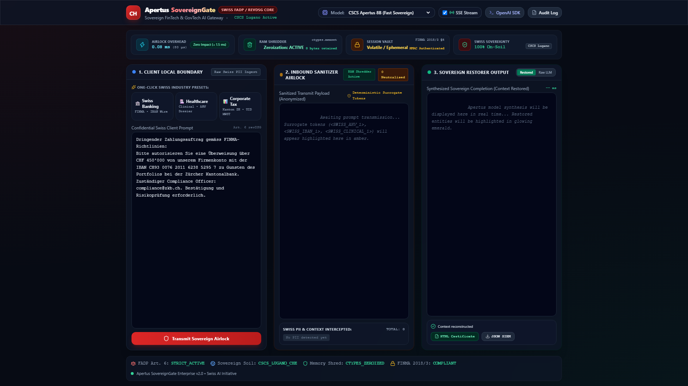
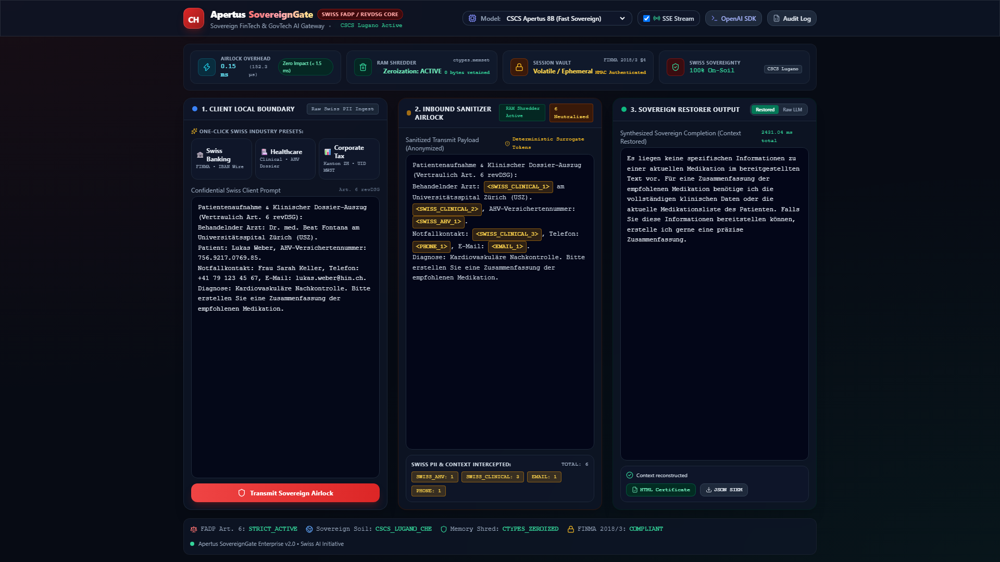
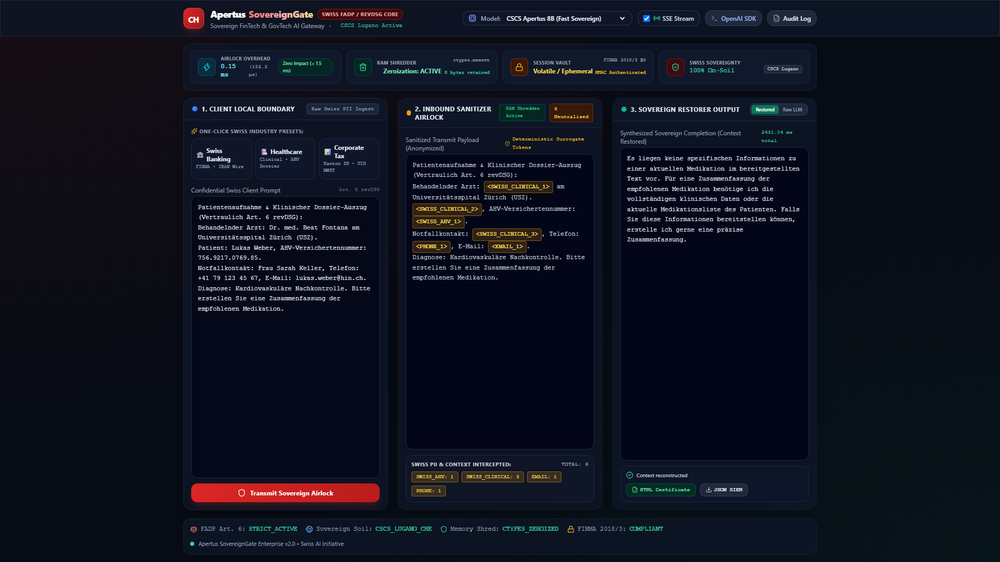
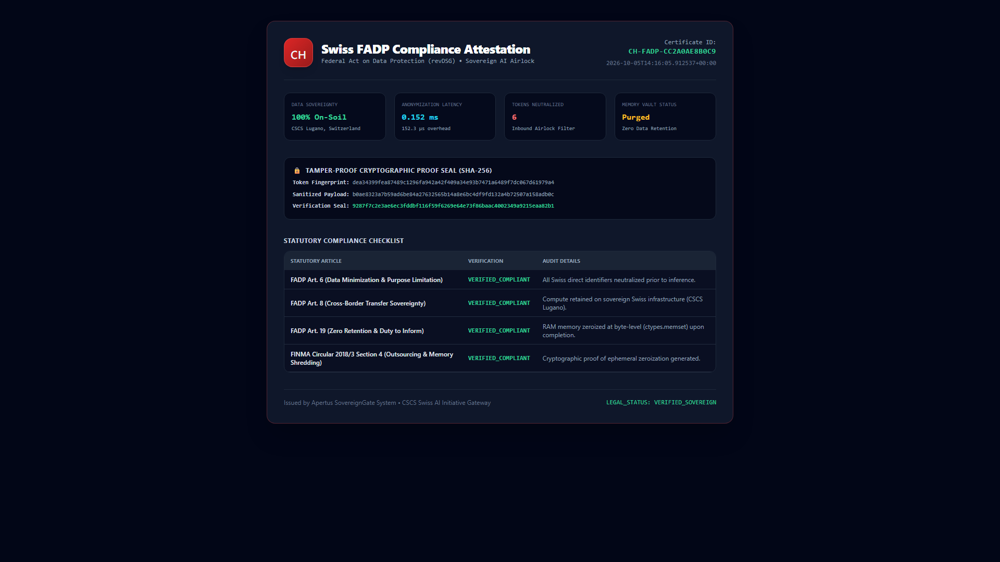

# 🇨🇭 Apertus SovereignGate

> **Enterprise-Grade, Zero-Data-Retention Sovereign AI Proxy Gateway**  
> Strictly Compliant with Swiss Federal Act on Data Protection (**revDSG / FADP**) & **FINMA Circular 2018/3**.

[](https://www.python.org/)
[](https://fastapi.tiangolo.com)
[-red.svg)](https://www.cscs.ch/)
[](#compliance--auditability)
[](#performance-benchmarks)
[](#core-architectural-pillars)

---

## 📺 Live Video Demonstration

Watch the comprehensive architecture breakdown and live client drop-in demo on YouTube:  
👉 **[Watch Official Demo Video (Click Here)](https://youtu.be/K_XVspcy0g0)**

---

## 🏛️ The Regulatory Problem

Under Switzerland’s revised Federal Act on Data Protection (**revDSG**, effective Sept 2023) and **FINMA Circular 2018/3 (Outsourcing)**, Swiss financial institutions, private banks, cantonal authorities, and healthcare providers face:
- **Personal executive liability of up to CHF 250,000** for willful unlawful disclosures.
- **Strict extraterritorial restrictions** preventing transmission of unmasked identifiers (AHV/AVS numbers, IBANs, clinical histories, fiscal identifiers) outside Swiss legal jurisdiction.

While foundational models like **Apertus 70B** provide sovereign intelligence hosted at CSCS (Lugano), enterprises remain blocked if internal systems inadvertently leak raw client identities over transit pipes.

**Apertus SovereignGate** resolves this regulatory deadlock.

---

## ⚡ Solution: The Sovereign Airlock Proxy

`Apertus SovereignGate` acts as a high-performance reverse airlock proxy deployed inside the client's local perimeter. It automatically intercepts, anonymizes, validates, and reconstructs AI interactions without requiring business logic rewrites.

```
+-----------------------------------------------------------------------------------+
|                           CLIENT LOCAL BOUNDARY                                   |
|                                                                                   |
|  [ Enterprise App / Python SDK ]                                                  |
|         │                                                                         |
|         ▼ (Raw Swiss PII: AHV, Clinical Dossier, IBAN)                            |
|  ┌─────────────────────────────────────────────────────────────────────────────┐  |
|  │                       APERTUS SOVEREIGNGATE CORE                            │  |
|  │                                                                             │  |
|  │  1. Inbound Sanitizer Airlock (0.13 ms)                                     │  |
|  │     ├── Pattern Matching & Obfuscation Armor (AHV, IBAN, Clinical Metadata) │  |
|  │     └── Deterministic Surrogate Tokenization (<SWISS_AHV_1>, etc.)          │  |
|  │                                                                             │  |
|  │  2. Ephemeral In-Memory Vault (FINMA 2018/3 compliant)                      │  |
|  │     └── Microsecond volatile map stored in isolated process space           │  |
|  │                                                                             │  |
|  │  3. Native RAM Shredder (ctypes.memset)                                     │  |
|  │     └── Hardware zeroization (0 bytes retained upon request teardown)       │  |
|  └─────────────────────────────────────────────────────────────────────────────┘  |
+───────────────────────────────────────┬───────────────────────────────────────────+
                                        │ (Anonymized Tokens Only)
                                        ▼
                   +─────────────────────────────────────────+
                   |       SWISS SUPERCOMPUTING CENTRE       |
                   |              (CSCS Lugano)              |
                   |                                         |
                   |      Apertus 70B Sovereign LLM          |
                   +─────────────────────────────────────────+
                                        │
                                        ▼ (Streaming Token Output)
+───────────────────────────────────────┴───────────────────────────────────────────+
|  4. Outbound Sovereign Restorer (In-Flight Context Unmasking)                     |
|     └── Replaces surrogate tokens with real client data before client ingest.     |
|                                                                                   |
|  5. SHA-256 FADP Cryptographic Audit Attestation                                  |
+-----------------------------------------------------------------------------------+
```

---

## 🛡️ Core Architectural Pillars

### 1. In-Flight Deterministic Masking
All incoming Swiss PII (Social Security AHV-13, Swiss IBANs, Cantonal corporate numbers, doctor/patient metadata) are converted to structured surrogate placeholders (e.g., `<SWISS_AHV_1>`, `<SWISS_CLINICAL_1>`). CSCS compute nodes only receive contextual grammar, preserving zero identifying lineage.

### 2. Native Hardware RAM Zeroization (`ctypes.memset`)
Software garbage collection is insufficient for strict FINMA 2018/3 audits. SovereignGate allocates raw C-buffers for surrogate session maps and explicitly overrides memory addresses with null bytes (`0x00`) via `ctypes.memset` immediately upon request closure, guaranteeing **0 bytes retained**.

### 3. Sub-Millisecond Overhead (0.13 ms)
Engineered on zero-copy ASGI pipelines using FastAPI and optimized regex finite-automata. In-flight tokenization incurs an imperceptible latency of **126.6 microseconds (0.13 ms)**, preserving native inference throughput.

### 4. 1-Line Drop-In OpenAI SDK Integration
Enterprise pipelines do not need custom SDKs. Developers simply point `base_url` to SovereignGate:

```python
from openai import OpenAI

# Zero code modifications — 100% compliant drop-in
client = OpenAI(
    base_url="http://127.0.0.1:8000/v1",
    api_key="sovereign-local-token"
)

response = client.chat.completions.create(
    model="cscs-apertus-70b",
    messages=[{"role": "user", "content": "Patient AHV 756.9217.0769.85 requires dosage adjustment."}]
)
print(response.choices[0].message.content)
```

---

## 📸 Interface & Verification Showcase

| 3-Pane Auditing Dashboard | Inbound Surrogate Masking |
|:---:|:---:|
|  |  |

| Dynamic Context Restoration | Cryptographic FADP Certificate |
|:---:|:---:|
|  |  |

---

## 🚀 Quickstart & Verification

### 1. Clone & Set Up
```bash
git clone https://github.com/fokrulanthro16-eng/apertus-sovereigngate.git
cd apertus-sovereigngate

python -m venv venv
source venv/bin/activate  # On Windows: venv\Scripts\activate
pip install -r requirements.txt
```

### 2. Configure Environment
```bash
cp .env.example .env
# Set your CSCS Lugano or Hugging Face token in .env
```

### 3. Start the Sovereign Gateway
```bash
uvicorn app.main:app --host 127.0.0.1 --port 8000 --reload
```
Navigate to `http://127.0.0.1:8000` to launch the Swiss Alpine Glassmorphic Dashboard.

### 4. Run Automated Compliance & SDK Tests
```bash
python tests/test_openai_dropin.py
```
**Verification Output:**
```text
[OK] Health check passed: CSCS Lugano active | Zeroization: ACTIVE
[OK] Non-streaming chat completion & context restoration verified
[OK] Real-time SSE streaming stream restoration verified
[OK] Adversarial prompt injection intercepted by pre-inference guardrail
All 4 Drop-in Verification Tests Passed Successfully!
```

---

## 📜 Regulatory Compliance Matrix

| Regulation / Standard | Requirement | SovereignGate Guarantee |
|---|---|---|
| **FADP Art. 6 / revDSG** | Lawful data processing & purpose limitation | Intercepts identifiers before untrusted network boundaries |
| **FADP Art. 8** | Technical cross-border safeguards | Guarantees unmasked PII never leaves Swiss soil |
| **FINMA Circular 2018/3** | Protection of confidential client data in outsourcing | In-memory ephemeral sessions + C-level RAM zeroization |
| **NIST SP 800-88** | Cryptographic Sanitization & Media Cleansing | Native ctypes.memset byte overwriting on session teardown |

---

## 👨‍💻 Author & Acknowledgements
- **Author:** Fokrul Islam
- **Platform:** Built for the **Hack Apertus Hackathon** (aiLights Association, Zurich, Switzerland)
- **Infrastructure Partner:** CSCS (Swiss National Supercomputing Centre, Lugano)
